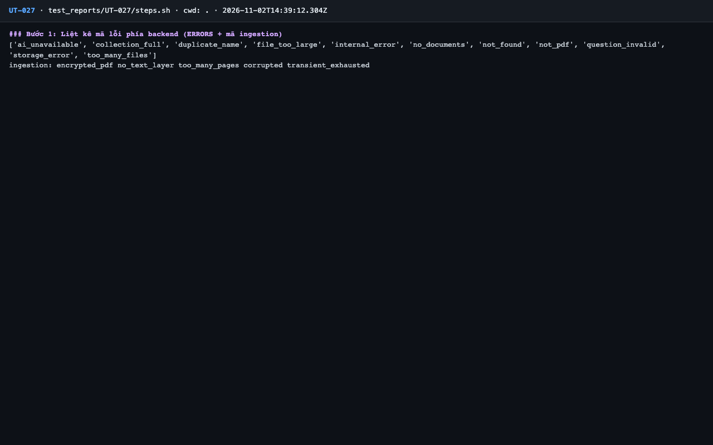
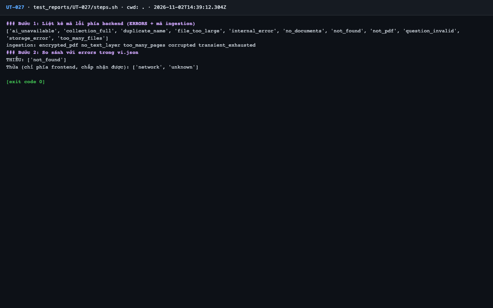

# Báo cáo kiểm thử — UT-027: Mọi mã lỗi đều có thông điệp tiếng Việt trong vi.json

| Mục | Giá trị |
|---|---|
| Test case | [UT-027](../../docs/07-verification/test_cases/UT-027.md) |
| Kết luận | **❌ Không đạt** |
| Thời gian chạy | 2026-11-02 21:39:11 → 21:39:14 (UTC+7) |
| Người / agent thực hiện | Claude Code (agent), `frontend/e2e/run-cli.mjs` + `steps.sh` |
| Commit | `c02cc72 (có thay đổi chưa commit)` |
| Môi trường | localhost · web http://localhost:5173 · API http://localhost:8000 · Darwin 27.0.0 arm64 · Docker 29.6.2 · ANTHROPIC_API_KEY: không |
| Script | [steps.sh](steps.sh) |

## Kết quả từng bước

| # | Thao tác | Kết quả mong đợi | Kết quả thực tế | Đạt? | Bằng chứng |
|---|---|---|---|---|---|
| 1 | Liệt kê mã lỗi phía backend (ERRORS + mã ingestion) | Danh sách 11 mã của ERRORS và 5 mã ingestion | `ingestion: encrypted_pdf no_text_layer too_many_pages corrupted transient_exhausted`; `['ai_unavailable', 'collection_full', 'duplicate_name', 'file_too_large', 'internal_error', 'no_documents', 'not_found', 'not_pdf', 'questio` | ✅ | [ảnh](screenshots/01-buoc-1-liet-ke-ma-loi-phia-backend-errors-ma-ingestion.png) |
| 2 | So sánh với `errors` trong vi.json | `THIẾU: []` | THIẾU: ['not_found'] | ❌ | [ảnh](screenshots/02-buoc-2-so-sanh-voi-errors-trong-vi-json-ket-thuc.png) |

## Bằng chứng

- Video: [video.webm](video.webm)
- Log: [logs/run-meta.json](logs/run-meta.json), [logs/steps.log](logs/steps.log)
- Ảnh:

  

  

## Lỗi phát hiện

| # | Mô tả | Mức độ (Blocker / Critical / Major / Minor) | Bước | Bằng chứng |
|---|---|---|---|---|
| 1 | Mã `not_found` có trong `platform/errors.py::ERRORS` nhưng thiếu trong `vi.json` (`errors.not_found`), trái quy tắc AGENTS.md: người dùng sẽ thấy thông điệp chung. Mức độ theo ghi chú của test case | Major | 2 | [logs/steps.log](logs/steps.log) |

## Ghi chú và sai lệch so với test case

Không có.
